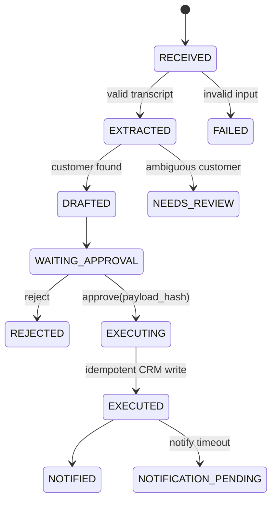

# Chapter 00 Reference Solutions

先交自己的版本再看。答案可不同，但必須滿足驗收條件。

## 00.1

| 任務 | 不確定性 | 影響 | Pattern | 理由 |
|---|---:|---:|---|---|
| 固定時間備份 | 1 | 4 | automation | 步驟固定，失敗應告警 |
| 客訴摘要 | 3 | 2 | copilot | 人員仍負責判斷與回覆 |
| 根據政策草擬退款 | 4 | 4 | agent | 需查訂單與政策；退款前核准 |
| 薪資計算 | 1 | 5 | rule | 金額必須由確定性規則計算 |

核心不是 Agent 數量，而是讓不確定性只存在於需要語意判斷的步驟。

## 00.2

CRM 已成功時不應因通知失敗回滾客戶資料；保留 `EXECUTED + NOTIFICATION_PENDING`，獨立重試通知。

## 00.3

`.env.example` 只列設定名稱與安全範例，可 commit；`.env` 放環境實值，不可 commit。`uv` 能下載並固定指定 Python，避免系統只有 3.10 或命令名稱不同。

## 00.4

合格成功指標範例：以 200 件 holdout 工單，正確 routing ≥90%、高風險漏轉人工率 0%、p95 <10 秒、每件成本 <$0.05；PoC 只建立草稿，不自動關單或寄信。

